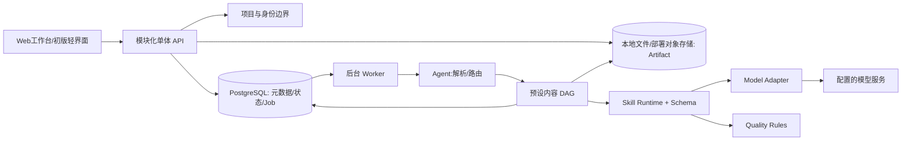

> AI Content Workforce · G0.1 · 2026-11-24（Asia/Shanghai）
> G0.1 已获批准 · Phase 1 Engineering Foundation V1.0 已实施，待产品负责人验收；未进入 Phase 2。

# Greenfield MVP 架构

## 推荐形态
模块化单体 Web API + 一个独立后台 Worker 进程（同一代码仓库、同一版本、可本地共进程运行）。PostgreSQL 持久化项目、运行、节点/Artifact 元数据和任务队列记录；本地开发使用文件系统Artifact目录，部署后可替换为兼容对象存储。单进程入口提交事务内的持久Job，再由Worker轮询/领取；MVP不需要独立消息代理。Worker重启后可按run/node状态恢复。

Agent 只完成请求解析、补参和选择固定workflow_id@version。Workflow 静态DAG和受控表达式由代码/登记配置提供。Skill Runtime 调用同进程Prompt/Schema/Model Adapter函数，不执行任意代码。可在将来抽换模块而不先拆微服务。

## 持久执行的最小语义
每个nodeAttempt以事务记录running和lease；成功产物写临时文件并hash，完成Schema校验后持久化Artifact和成功状态。进程崩溃租约过期后重试可重试节点；生成调用重复只接受当前revision的结果。模型成本/用量如供应商支持记录，否则标unknown。错误、超时、用户取消可以终止或恢复。人工编辑通过新版本Artifact，使下游节点失效。

MVP只需顺序节点、单Worker、有限重试、取消请求、从失败节点恢复、revision、基本人工确认和成本记录；并行/复杂条件分支、多Worker公平调度、租约栅栏等在基础机制证明必要后再加。

## 扩展边界
内部PlatformProfile含标题/正文约束、标签结构、图文语义和输出适配；MVP只启用小红书草稿格式。ModelAdapter隔离供应商API。ImageGenerationProvider可空配置；只有真实配置、返回文件并验证hash/元数据时才出现 generated artifact。ProjectId从服务端认证派生。Artifact存储通过接口由本地文件系统换对象存储，数据库保留项目键和元数据。

无任何现网兼容/迁移前提，也不引入已有小红书仓库代码作为架构底座。
